# Media Gen Pro MCP

**Give your AI assistant real image generation, and get back files you can actually use.**

Ask Claude to build you a landing page and you'll get a lovely layout with `hero-image.png` referenced everywhere and no hero image anywhere. This fixes that. Your assistant describes the picture it needs, this makes it, and it hands back a file path that an `` can point at.

You need at least one API key. Setup takes about five minutes.

```json
{
  "mcpServers": {
    "media-gen-pro": {
      "command": "npx",
      "args": ["-y", "media-gen-pro-mcp"],
      "env": {
        "OPENAI_API_KEY": "paste-your-key-here",
        "IMAGE_GEN_OUTPUT_DIR": "/absolute/path/to/your/project/public/images"
      }
    }
  }
}
```

## What you get back

Paths, not pictures.

```
Generated 2 image(s) with **Gemini 3.1 Flash Image** via the direct route.

- `/Users/you/site/public/images/hero-4be44f.jpg` (332 KB, image/jpeg)
- `/Users/you/site/public/images/hero-40cab6-2.jpg` (318 KB, image/jpeg)

_Used 1 reference image._

_58 image(s) left this hour._
```

That's deliberate, and it's the main design decision in here. A 1024x1024 image is roughly 1.4 MB once it's base64'd into a chat. Three of those is a chunk of the conversation spent on bytes your assistant can't look at anyway. You wanted a file; here's the file.

## The models

One tool, several models, because the right one genuinely differs by job. **Name one with `style` and it is used exactly; leave it out and the server reads your prompt and picks.**

Routing costs one call on a flash-lite model, about a second, and the choice and its reason come back with the result:

```
Generated 1 image(s) with **GPT Image 2** via the direct route.

_Model chosen from your prompt: the prompt requires an exact count of seven items
in a specific spatial arrangement. Pass `style` to override._
```

It routes on the comparison further down rather than on vendor marketing. Seven test prompts, seven correct picks: an exact count went to GPT Image 2, a photograph to Recraft, a flowchart to Arrow, an exclusion to GPT Image 2, an ordinary illustration to Gemini Flash, a quick draft to Grok, and a stated light direction to Gemini 3 Pro, which is the one that got that right when Flash inverted it.

Without a gateway key the classifier cannot run, and the request falls back to whichever key you did supply, saying so.

| Say this | You get | Good for | Needs |
|---|---|---|---|
| nothing | **GPT Image 2** (OpenAI) | the general default, strong text rendering | `OPENAI_API_KEY` or the gateway |
| `gemini`, `nanobanana` | **Gemini 3.1 Flash Image** | fast, cheap, good with reference images | `GEMINI_API_KEY` or the gateway |
| `gemini-pro`, `geminipro` | **Gemini 3 Pro Image** | the same route, slower and more obedient | `GEMINI_API_KEY` or the gateway |
| `recraft`, `photo`, `photoreal` | **Recraft V4.1 Pro** | photorealism | the gateway |
| `seedream`, `bytedance` | **Seedream 5.0 Pro** | rich illustration; slow, up to ~100s | the gateway |
| `grok`, `imagine` | **Grok Imagine** | fast (~6s) | the gateway |
| `grok-cli`, `subscription` | **Grok Imagine**, on your Grok CLI login | fastest here (~4s), and it costs no credit | the Grok CLI, signed in |
| `svg`, `arrow` | **Arrow 1.1** | real SVG, editable vector source | the gateway |

"nanobanana" is in there because that's what people call Gemini's image model out loud. A server that only accepts the official string makes you look up a name you already know.

## Real SVGs

Set `svg: true` and you get vector source from Arrow 1.1: actual `<svg>` markup built from shapes and geometry, which you can open, edit and scale. The raster models can't do this. Ask any of them for an SVG and you get a picture that looks like one, which is a different thing and useless if you wanted to change the colour of one path.

After an SVG, the tool suggests offering you a raster version too, in a similar flat style, from one of the picture models. It won't generate that unasked; it's a second billed call.

## Seven models, six hard prompts

One prompt per category, shown in full below each heading, the same text sent to all seven, one generation each, nothing cherry-picked and nothing retried. The prompts are deliberately awkward: each one states a rule you can check by counting or looking, so you can grade the results yourself instead of taking my word for which is prettier.

Run 30 July 2026. These are single samples, not a benchmark. Re-run any of them and you may get a different answer.

### 1. Exact count and arrangement

> Exactly seven identical brass hexagonal bolts on a plain grey surface, arranged as two rows of three with the seventh bolt standing upright on its end at the front centre. No bolt touches another.

| GPT Image 2 | Gemini 3.1 Flash | Gemini 3 Pro | Recraft V4.1 Pro |
|---|---|---|---|
|  |  |  |  |
| **7, correct layout, nothing touching** | 7, correct layout, one bolt touching | **7, correct layout, nothing touching** | 6 |

| Seedream 5.0 Pro | Grok Imagine | Arrow 1.1 (SVG) |
|---|---|---|
|  |  | 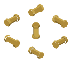 |
| 7, upright one behind not in front, several touching | 5, single row | 7, upright one centred, but a ring rather than rows |

GPT Image 2 and Gemini 3 Pro are the clean passes. Recraft produced by far the best photograph of the six and got the count wrong, which is the trade in one image. Arrow counted correctly (it emits seven shapes, so the count is in the source) and ignored the layout.

### 2. Absence

> An empty hotel corridor at 3am. No people, no reflections in any mirror, no light under any door, nothing on the floor. Bare carpet, closed doors, one ceiling light.

| GPT Image 2 | Gemini 3.1 Flash | Gemini 3 Pro | Recraft V4.1 Pro |
|---|---|---|---|
| 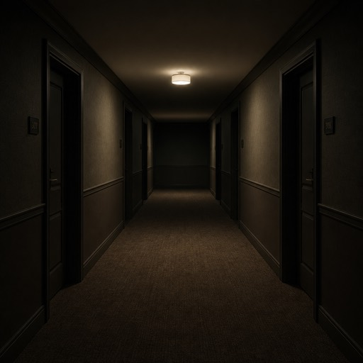 | 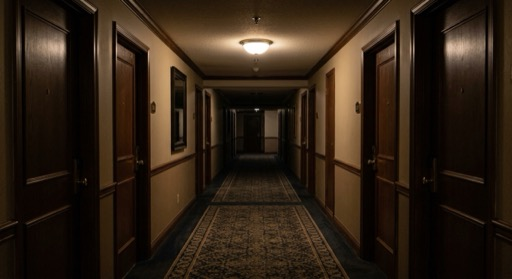 |  |  |

| Seedream 5.0 Pro | Grok Imagine | Arrow 1.1 (SVG) |
|---|---|---|
|  | 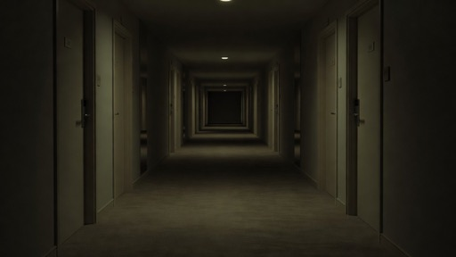 | 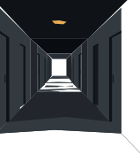 |

Text encoders have no NOT operator, so "no mirrors" tends to summon mirrors. GPT Image 2 came back fully compliant: nobody there, nothing on the floor, no light under any door, one fitting. Seedream put two framed mirrors on the walls and two ceiling lights, and stamped "AI generated" across the corner.

### 3. Attribute binding against the obvious pairing

> Five objects in a row on a white studio backdrop: a matte black ceramic banana, a glossy yellow steel wrench, a translucent green wooden mug, a brushed copper cloth apple, a rough concrete glass fish.

| GPT Image 2 | Gemini 3.1 Flash | Gemini 3 Pro | Recraft V4.1 Pro |
|---|---|---|---|
| 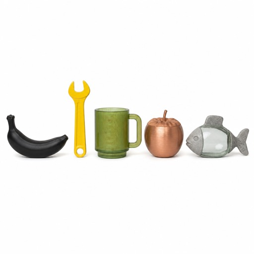 | 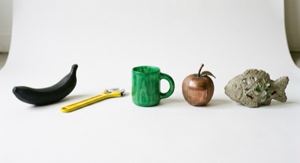 | 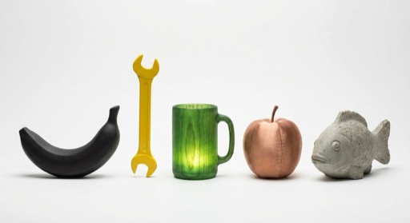 |  |

| Seedream 5.0 Pro | Grok Imagine | Arrow 1.1 (SVG) |
|---|---|---|
|  | 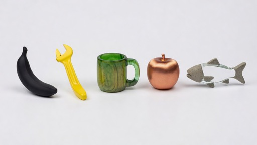 | 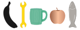 |

Every colour is deliberately wrong for its object, so a yellow banana is a visible failure rather than a matter of taste. GPT Image 2 bound all five and made a decent fist of the materials. Grok bound all five too, at a third of the time, then melted the wrench and drew the fish as a wireframe.

### 4. Geometric constraint

> A clean flowchart: three rectangular boxes in a horizontal row connected left to right by two straight arrows. Every line at exactly 0 or 90 degrees, uniform gaps between boxes, no crossing lines, thin uniform stroke weight, flat colour, no shading.

| GPT Image 2 | Gemini 3.1 Flash | Gemini 3 Pro | Recraft V4.1 Pro |
|---|---|---|---|
| 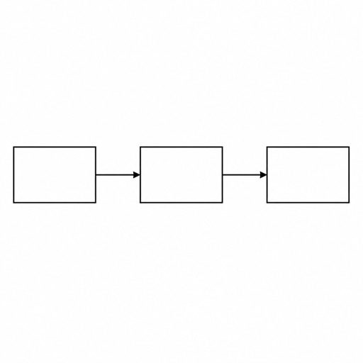 |  |  | 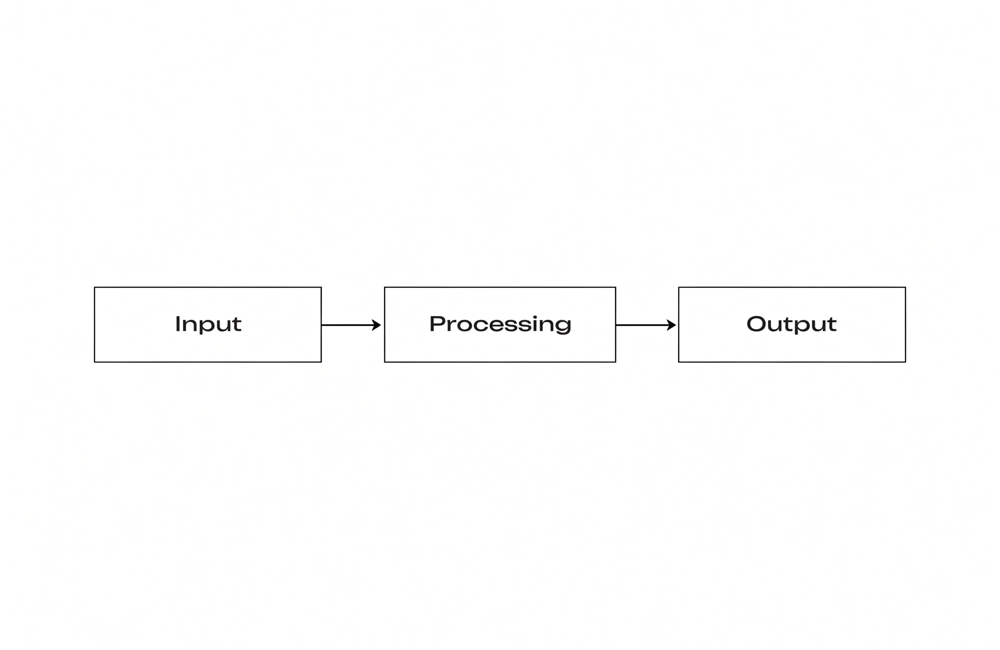 |

| Seedream 5.0 Pro | Grok Imagine | Arrow 1.1 (SVG) |
|---|---|---|
| 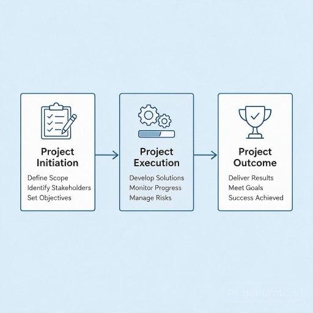 | 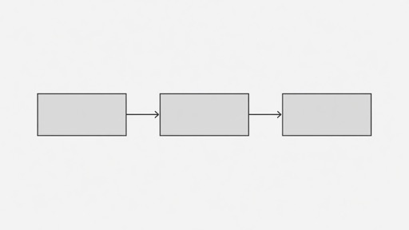 |  |

This is the category the vector model exists for, and it wins it: exact geometry, uniform stroke, labelled boxes, and you can open the file and edit any of it. Recraft came second and labelled its boxes too, with uneven widths. GPT Image 2 drew clean unlabelled boxes of three different sizes. Zoom in on any of the raster ones and the "straight" lines wobble, because a sampler is hallucinating straightness pixel by pixel rather than drawing a line.

### 5. Reflection and shadow

> A chrome kettle on a mirrored tabletop beside a window at 4pm. The reflection in the tabletop shows the underside of the kettle, and its shadow falls away from the window across the table.

| GPT Image 2 | Gemini 3.1 Flash | Gemini 3 Pro | Recraft V4.1 Pro |
|---|---|---|---|
| 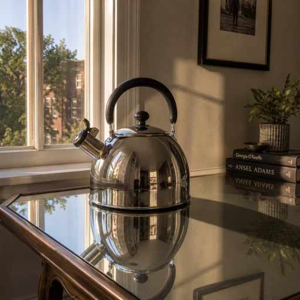 | 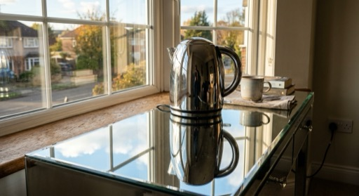 |  |  |

| Seedream 5.0 Pro | Grok Imagine | Arrow 1.1 (SVG) |
|---|---|---|
|  |  | 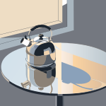 |

Reflections are the reliable giveaway of a model compositing plausible patches rather than simulating a scene. Recraft's is the photograph you would actually ship, and its reflection is a mirror-flip of the kettle's side rather than the underside the brief asked for. Arrow, which cannot photograph anything, got the structure right: reflection present, shadow falling away from the window, light patch on the table.

### 6. A person, with the pose specified

> A woman in her fifties sitting on a wooden stool against a bare plaster wall, three-quarter view facing left, wearing a plain charcoal roll-neck jumper. Her hands rest one on top of the other on her left knee, with exactly five thin silver rings between them. Single hard window light from the right, casting her shadow onto the wall to the left. Sharp focus on the eyes, shallow depth of field, 85mm.

| GPT Image 2 | Gemini 3.1 Flash | Gemini 3 Pro | Recraft V4.1 Pro |
|---|---|---|---|
|  |  |  |  |
| pose right, 2-3 rings | **shadow on the wrong side** | shadow correct, hands not stacked | best photo, ~5 rings |

| Seedream 5.0 Pro | Grok Imagine | Arrow 1.1 (SVG) |
|---|---|---|
|  |  | 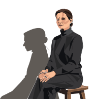 |
| facing camera, hands side by side | facing camera, hands side by side | pose right, ~5 rings, flat |

Four checkable things: which way she faces, whether one hand sits on the other, how many rings, and which side the shadow falls. Gemini 3.1 Flash lit her from the left and threw the shadow right, which is the one unambiguous miss in the whole run. Gemini 3 Pro, on the identical prompt, got it right, which is the clearest reason to reach for the slower sibling. Recraft produced the photograph you would ship and turned three-quarter into near-profile. Arrow, which cannot photograph anyone, followed the pose most closely of the six.

### What this suggests

Nothing here is a benchmark, but the shape is consistent enough to route by:

- **GPT Image 2** for briefs with rules in them. It was the only model to pass the count outright and the only one to honour every "no" in the absence prompt.
- **Recraft V4.1 Pro** when it has to look like a photograph, and check the details yourself.
- **Arrow 1.1** for anything diagrammatic, where it is not competing with the others so much as doing a different job.
- **Gemini 3.1 Flash** as the cheap default, with the caveat that it is the one model observed to invert a stated light direction.
- **Gemini 3 Pro Image** when Flash gets something wrong. Same key, same route, roughly twice the wait; it passed the count and fixed Flash's lighting miss.
- **Grok Imagine** when you want six options in the time another model takes for one.
- **Seedream 5.0 Pro** last on this evidence: slowest by a wide margin, and it watermarks.

_I inspected 22 of these 42 images closely; the notes above cover those and the rest are here for you to judge. Every file is in [`docs/examples/`](docs/examples/)._

## Video

```json
"env": { "AI_GATEWAY_API_KEY": "...", "IMAGE_GEN_OUTPUT_DIR": "/abs/path/public/media" }
```

`generate_video` is a separate tool from `generate_image`, deliberately. A clip takes tens of seconds to minutes, costs far more per output, and the most useful input is usually a still you already have. Putting that behind a flag on the image tool would be a parameter that multiplies your bill by an order of magnitude.

| Say this | You get | Needs |
|---|---|---|
| nothing, or `seedance` | **Seedance 2.0 Fast** | the gateway |
| `minimax`, `h3` | **MiniMax H3** | the gateway |
| `grok`, `imagine` | **Grok Imagine Video 1.5** | the gateway |
| `gemini`, `google`, `omni` | **Gemini Omni Flash** | the gateway |

Pass `sourceImage` and the still becomes the first frame. That is the strongest lever here and the only way to keep a subject consistent across clips: generate a still with `generate_image`, then animate it.

### The same three prompts, four models

Two clips seeded from the stills in the comparison above, one from text alone. 5 seconds each, one generation, nothing retried.

| | Seedance 2.0 Fast | MiniMax H3 | Grok Imagine Video 1.5 | Gemini Omni Flash |
|---|---|---|---|---|
| **kettle** (from a still) | [mp4](docs/examples/video/kettle-seedance.mp4), 110s | [mp4](docs/examples/video/kettle-minimax.mp4), 229s | [mp4](docs/examples/video/kettle-grok.mp4), 19s | [mp4](docs/examples/video/kettle-gemini.mp4), 34s |
| **portrait** (from a still) | refused | [mp4](docs/examples/video/portrait-minimax.mp4), 246s | [mp4](docs/examples/video/portrait-grok.mp4), 19s | [mp4](docs/examples/video/portrait-gemini.mp4), 37s |
| **text only** | [mp4](docs/examples/video/text-seedance.mp4), 109s | [mp4](docs/examples/video/text-minimax.mp4), 221s | [mp4](docs/examples/video/text-grok.mp4), 23s | [mp4](docs/examples/video/text-gemini.mp4), 32s |

Grok was an order of magnitude faster on every one. Treat that with suspicion rather than as a benchmark: an earlier run of the identical three prompts timed out at 600 seconds on all three, and I cannot account for the difference.

Seedance refuses a photographic face as a source frame ("may contain real person"). That is its own moderation, not a bug here, and the tool reports it as a refusal with what to do instead: seed from an image you generated rather than a photograph.

### Rough edges

**Gemini Omni Flash is not a video model on the gateway.** It is typed `language`, the same trap as Gemini's image models: a multimodal LLM that emits video files rather than a video endpoint. The video API refuses it; `generateText` reaches it and the clip arrives on the response's files.

**MiniMax needs an explicit aspect ratio for text-to-video.** Omitting it sends `adaptive`, which it rejects outright. The server passes `16:9` when you give no ratio and there is no source image.

**Grok Imagine Video on a CLI subscription is present but disabled.** The endpoint, the poll path and the accepted ratios are all known, learned from its own error messages: `POST /v1/videos/generations` returns a `request_id`, the result comes from `GET /v1/videos/{id}`, and `auto` is not a valid ratio there even though it is for images. What is not known is the shape of the `image` field: both a data URL and a bare base64 string are refused with `invalid type: string`, and the account ran out of video credit before the right shape turned up. Shipping it as working would mean a route that fails on two of its three uses.

## Writing a prompt that works

Front-load the subject, then action or pose, setting, style, composition, lighting, key details. Natural prose rather than keyword tags, two to five sentences. Say what to include rather than what to leave out. One scene per prompt.

Two things worth knowing before you reach for this at all:

**If it needs exact text, real numbers, or a correct structure, build it in code.** Charts from data, labelled diagrams, tables, UI mockups, multi-panel grids. Image models garble words, invent numbers, and draw bars that match no data, and re-prompting garbles them again. HTML and CSS give you exact values and a layout you control; screenshot that. Use this server for the parts where only the look matters.

**Nothing here remembers a subject between calls.** Two generations of "the same" character always drift. Generate one canonical image, then pass its path in `referenceImages` on every later call and restate the fixed traits each time.

The tool result tells you both of these when the prompt looks like it needs them, along with which model handled that kind of brief best in the comparison above.

## When a model says no

Providers refuse things. When one does, the result explains what to do instead rather than just reporting the error, and it tells the calling agent not to reword its way past the filter or shop the prompt around other models.

The suggestions only move in one direction: from naming an entity toward describing an aesthetic. "In Pixar style" is usually not a request for that studio at all, it is a request for stylised 3D animation, and naming the properties gets a better image than naming the studio would have:

> stylised 3D character animation, oversized eyes with visible catchlights, soft subsurface scattering on the skin, rounded simplified forms, warm key light with cool bounce, shallow depth of field

Same for a borrowed character: describe the build, costume shapes, silhouette and expression you actually want, and the result is reusable as a `referenceImages` anchor, which a trademark never is.

Where a request has no legitimate version, it says so and offers nothing. That distinction is the whole point of the feature.

## Reference images and context

Two things beyond the prompt, and both change the result.

**Reference images.** Paths to files on your machine. Use them to match an existing style, keep a product or character consistent across a set, or edit an image you already have.

**Context.** Extra text kept separate from the prompt: brand rules, a palette, what the surrounding page says, what to avoid. Separate so the subject stays legible instead of drowning in instructions.

```
prompt:          "Hero illustration: a paper aeroplane over a pale gradient"
referenceImages: ["/Users/you/brand/style-sheet.png"]
context:         "Match the brand palette in the reference. Flat vector, no gradients on the subject, no text anywhere in the image."
n:               3
```

**Note:** reference images are read from disk by this server, so absolute paths are safest, and they must be readable by whatever runs the MCP. They're not URLs and not base64.

## Rough edges, said plainly

**GPT Image 2 needs project access your OpenAI account might not have.** Mine doesn't. The error is clear when it happens (`Project ... does not have access to model gpt-image-2`), but it's the default model, so if you hit it on your first try, that's why. Check your project's model permissions in the OpenAI dashboard, or just use `gemini` instead.

**Gemini can't do more than one image per call.** Asking for three means three requests behind the scenes, fanned out in parallel. Worth knowing why three Gemini images take about as long as one and cost three times as much.

**Nobody agrees what format they're returning.** Gemini returns JPEG, Recraft returns WebP, and Arrow returns SVG source labelled `image/png`. The server sniffs the actual bytes and names the file accordingly rather than trusting the label, so you get `.jpg`, `.webp` and `.svg` where those are what arrived. Nothing for you to do; it's just why extensions vary.

**Recraft goes through a different endpoint.** The gateway's own image-model route answers with an error for every Recraft model, so this uses its OpenAI-compatible endpoint instead, which serves them correctly. Checked 30 July 2026.

## Getting a key

You need at least one. Any one is enough to start.

**OpenAI** ([platform.openai.com/api-keys](https://platform.openai.com/api-keys)) gives you GPT Image 2, subject to the access caveat above.

**Google AI Studio** ([aistudio.google.com/apikey](https://aistudio.google.com/apikey)) gives you Gemini 3.1 Flash Image. Sign in, click **Create API key**, copy it. This is the quickest one to get working.

**Or no key at all**, for one route: if you have xAI's `grok` CLI installed and signed in, `style: "grok-cli"` uses that session and bills your X Premium or SuperGrok subscription rather than any API balance. It reads the token from `~/.grok/auth.json`, never writes to it, and never refreshes it, because two programs writing one auth file is how a working login gets broken.

**Vercel AI Gateway** ([vercel.com/docs/ai-gateway](https://vercel.com/docs/ai-gateway)) gives you everything from one key, and it's the only way to reach Recraft, Seedream, Grok Imagine and Arrow, none of which have a first-party key here. If you only get one key, get this one.

Treat any of them like a password, because that's what they are. Don't paste one into a chat, don't commit one to a repo.

## About money, and a plain warning

**Every image costs you.** Image models are billed per image and they're the expensive kind, meaningfully more than a text call. Prices move, so check each vendor's current pricing rather than trusting a number written here.

**Set a budget before you start.** OpenAI, Google Cloud and Vercel all let you set a spending limit and an alert. It takes two minutes each and it's the difference between a surprise and a number you chose. If you only do one thing from this section, do that one.

This server ships with an hourly cap of 60 images, on by default, because an assistant stuck in a retry loop is exactly the thing that runs up a bill nobody agreed to. There's also a per-call cap of 4, so "generate some options" can't quietly become forty. Both are yours to raise, deliberately rather than by accident.

> **No liability for spend.** This is free software provided as-is under the MIT licence. You are responsible for your own API usage and any charges OpenAI, Google or Vercel bill you, including charges caused by bugs, misconfiguration, runaway agents, or anything else. Neither Luke Rhodes nor Fledgeling is liable for your spending. Set a budget.

## Settings

All optional except having at least one key. Set them alongside the key in the `env` block.

| Setting | Default | What it does |
|---|---|---|
| `OPENAI_API_KEY` | | Your OpenAI key. Reaches GPT Image 2 directly |
| `GEMINI_API_KEY` | | Your AI Studio key. `GOOGLE_API_KEY` works too, since Google's own tools read that one |
| `AI_GATEWAY_API_KEY` | | Vercel AI Gateway. Reaches everything, and is the only route to Recraft, Seedream, Grok Imagine and Arrow |
| _(none)_ | | `style: "grok-cli"` needs no key. It uses the Grok CLI's signed-in session, read from `~/.grok/auth.json` |
| `IMAGE_GEN_OUTPUT_DIR` | working directory | Where images are written. Point it at your project's image folder and the paths come back ready to use |
| `IMAGE_GEN_DEFAULT_PROVIDER` | whichever key you set | Pins the fallback used when routing cannot run. Defaults to OpenAI when you have a gateway or OpenAI key, Google when Gemini is all you have |
| `IMAGE_GEN_ALLOWED_STYLES` | unset (no restriction) | Style aliases this deployment can actually reach, comma-separated, e.g. `gemini-pro,gemini`. The classifier then chooses within the set, and a request it routes elsewhere is substituted by tier rather than refused. Set this wherever some vendors are unreachable — a Zero-Data-Retention gateway, a missing BYOK credential, a provider you have not enabled |
| `IMAGE_GEN_PREFER_GATEWAY` | `false` | Route through the gateway even when a direct key exists. Turn on to put all the billing in one place |
| `IMAGE_GEN_MAX_PER_HOUR` | `60` | Images per rolling hour. `0` removes the cap, knowing what that means for your bill |
| `IMAGE_GEN_MAX_PER_CALL` | `4` | Ceiling on one request, whatever the assistant asks for |
| `IMAGE_GEN_TIMEOUT_MS` | `180000` | How long to wait. Image models are slow; three minutes is not generous |

Two things the server handles that are worth knowing only if you're reading the code. The same model has different ids per route (`gemini-3.1-flash-image` direct, `google/gemini-3.1-flash-image` on the gateway). And Gemini's image models are multimodal *language* models, so they're reached through the text API, not the image one; the gateway types them `language` and refuses them on the image route.

## What it doesn't do

Worth saying plainly, so you know before you install it.

It doesn't return image data to your assistant, so your assistant can't look at what it made. It knows the file exists and where; it can't see whether the composition worked. Open the file yourself, or hand the path to a tool that can read images.

It doesn't upscale, crop, convert, or optimise. One job.

It won't rescue a vague prompt. Reference images help more than adjectives do.

## For developers

TypeScript, ESM, Node 20.11 or newer. FastMCP over stdio, Vercel AI SDK v7 (`generateImage`, not the removed `experimental_generateImage`), Zod at every boundary, `exactOptionalPropertyTypes` on, no `any`.

```bash
npm install
npm run gate     # typecheck, lint, test, build
```

Routing lives in `src/models.ts` as a table and a pure function, because routing is the part people get wrong and a chain of ifs spread through a handler is how it stays wrong.

## Who made this

I'm **Luke Rhodes**, a founder and engineer building [Fledgeling](https://www.fledgeling.app). I spent years shipping developer tools and got tired of proprietary formats and slow editors, so Fledgeling is the opposite of that: fast software built from scratch, your work in plain text you own, and AI as a collaborator you can always overrule. The human is always the editor of record.

I'm also co-founder of [Diolog](https://diolog.app) with Amy Benson, building investor-relations software for listed companies and the retail investors following them.

- GitHub: [github.com/lprhodes](https://github.com/lprhodes)
- LinkedIn: [linkedin.com/in/lukerhodes](https://www.linkedin.com/in/lukerhodes/)
- X: [x.com/lp_rhodes](https://x.com/lp_rhodes)
- Email: [hello@fledgeling.app](mailto:hello@fledgeling.app)

## Three related things

**[Google Search MCP](https://www.npmjs.com/package/google-search-api-mcp)** is this one's sibling. Where this makes pictures, that one does the looking: Google search through the Gemini API, returning the answer, the real source URLs (not Google's opaque redirects), and the queries the model actually ran.

```
npx -y google-search-api-mcp
```

**[Dossier](https://www.npmjs.com/package/dossier-research-mcp)** is the big one. It runs proper deep research: several backends on the same question at once (Gemini, Perplexity, OpenAI, xAI, plus any coding CLIs you're already paying for), then checks the citations resolve, flags where the backends disagree, and refuses to spend past a budget you set.

```
npx -y dossier-research-mcp
```

**[Margin](https://www.fledgeling.app)** is for teams rather than terminals. It turns internal reference docs into living pages you can comment on by typing or talking, listen to, and edit in place, with an embedded agent who rewrites sections from your feedback and commits the change to git. Members-only and invite-gated at the moment, with a waitlist.

## Licence

MIT. Use it, fork it, ship it.
